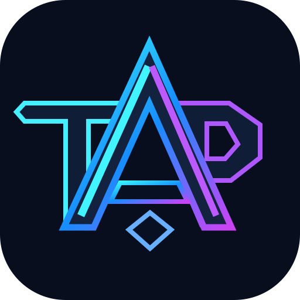

<div align="center">




<br />

**Independent engineering. Open ideas. Tools that move work forward.**

<sub>Building focused software at the intersection of AI systems, developer infrastructure, and native experiences.</sub>

<br /><br />

[](https://github.com/orgs/tapaixx/repositories)
[](https://github.com/tapaixx)
[](https://github.com/tapaixx)

<br />

**English** &nbsp;·&nbsp; [简体中文](https://github.com/tapaixx/.github/blob/main/profile/README.zh-CN.md) &nbsp;·&nbsp; [繁體中文](https://github.com/tapaixx/.github/blob/main/profile/README.zh-TW.md) &nbsp;·&nbsp; [日本語](https://github.com/tapaixx/.github/blob/main/profile/README.ja.md)

</div>

---

### `01 / OUR SIGNAL`

We build practical tools for people who work close to the metal: APIs, AI coding workflows, automation, and Apple platforms.

Our approach is simple: **make the complex observable, the repetitive programmable, and the everyday experience a little better.**

```text
> SYSTEM STATUS: BUILDING
> PRINCIPLES: clarity / reliability / curiosity
> INTERFACES: API · CLI · WEB · iOS
```

### `02 / FEATURED BUILDS`

<table>
<tr>
<td width="50%" valign="top">

#### ⚡ [Codex Header Rewrite](https://github.com/tapaixx/codex-header-rewrite)
**CONTROL / OBSERVE / DEBUG**

A native CLIProxyAPI plugin for credential-aware request-header rules, request diagnostics, and controlled inspection.

`Go` `API infrastructure` `CLIProxyAPI`

[Source →](https://github.com/tapaixx/codex-header-rewrite) · [Releases →](https://github.com/tapaixx/codex-header-rewrite/releases)

</td>
<td width="50%" valign="top">

#### ◉ [Codex Window Reset](https://github.com/tapaixx/codex-window-reset)
**SCHEDULE / INSPECT / OPERATE**

A CLIProxyAPI plugin for Codex account windows, quota management, manual health checks, and operational visibility.

`Go` `Automation` `Observability`

[Source →](https://github.com/tapaixx/codex-window-reset) · [Releases →](https://github.com/tapaixx/codex-window-reset/releases)

</td>
</tr>
<tr>
<td width="50%" valign="top">

#### ⌘ [Codeg for iOS Web](https://github.com/tapaixx/codeg-ios-web)
**CODE / ANYWHERE / NATIVE**

An iPhone and iPad shell for the codeg web client, with server switching, background agent awareness, Live Activities, and notifications.

`Swift` `iOS` `WebKit`

[Source →](https://github.com/tapaixx/codeg-ios-web)

</td>
<td width="50%" valign="top">

#### ◇ [Private Signer for iOS](https://github.com/tapaixx/private-signer-ios)
**INTEGRATE / SIGN / DELIVER**

A Swift package for iOS/iPadOS signing workflows, project discovery, signing jobs, and client-side integration with Private IPA Signer.

`Swift` `SDK` `Apple platforms`

[Source →](https://github.com/tapaixx/private-signer-ios)

</td>
</tr>
<tr>
<td width="50%" valign="top">

#### ▣ [CLIProxyAPI Plugins Store](https://github.com/tapaixx/CLIProxyAPI-Plugins-Store)
**DISCOVER / DISTRIBUTE / EXTEND**

A lightweight registry for CLIProxyAPI native plugins, with a structured catalog and release-based distribution.

`JSON` `Plugin ecosystem` `Tooling`

[Registry →](https://github.com/tapaixx/CLIProxyAPI-Plugins-Store)

</td>
<td width="50%" valign="top">

#### ∞ [Explore All Projects](https://github.com/orgs/tapaixx/repositories)
**EXPERIMENT / LEARN / SHIP**

An evolving collection of developer experiments, utilities, platform integrations, and open-source contributions.

`AI workflows` `Infrastructure` `Prototypes`

[Browse repositories →](https://github.com/orgs/tapaixx/repositories)

</td>
</tr>
</table>

### `03 / WHAT WE BUILD`

| 01 — AI WORKFLOWS | 02 — DEVELOPER INFRASTRUCTURE | 03 — NATIVE EXPERIENCES |
| :--- | :--- | :--- |
| Tools around coding agents, API behavior, and automation. | Plugins, observability, routing, and practical operational utilities. | Carefully integrated client experiences on iPhone and iPad. |
| **Make complex systems understandable.** | **Make infrastructure easier to operate.** | **Bring useful tools closer to people.** |

### `04 / CONNECT`

Found something useful? Explore the source, open an issue on the relevant repository, or propose a focused improvement.

**→ [Browse repositories](https://github.com/orgs/tapaixx/repositories)** &nbsp;&nbsp; **→ [Visit the organization](https://github.com/tapaixx)**

---

<div align="center">

<sub><code>TAPIAXX // BUILDING WITH INTENT</code></sub>

<sub>Independent projects. Honest engineering. Always iterating.</sub>

</div>
