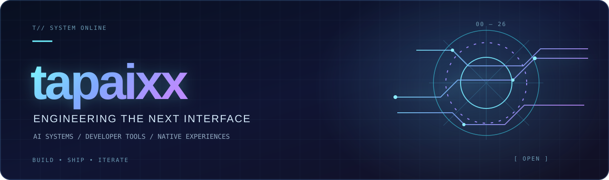

<div align="center">



<br />

**独立开发 · 开放理念 · 打造真正好用的工具**

<sub>专注于 AI 工作流、开发者基础设施与原生应用体验。</sub>

<br /><br />

**[English](https://github.com/tapaixx)** &nbsp;·&nbsp; **简体中文** &nbsp;·&nbsp; [日本語](./README.ja.md)

</div>

---

### `01 / 我们的理念`

我们致力于把复杂系统变得可观察、把重复操作变得可编程，让开发者每天使用的工具更稳定、更顺手。

**清晰、可靠、持续探索。** 我们关注 AI 编程工作流、API 基础设施、自动化以及 Apple 平台上的实用产品。

```text
> SYSTEM STATUS: BUILDING
> PRINCIPLES: 清晰 / 可靠 / 探索
> INTERFACES: API · CLI · WEB · iOS
```

### `02 / 精选项目`

| 项目 | 介绍 | 技术领域 |
| :--- | :--- | :--- |
| ⚡ **[Codex Header Rewrite](https://github.com/tapaixx/codex-header-rewrite)** | CLIProxyAPI 原生插件，提供凭证级请求头规则、请求诊断与受控检查。 | Go · API 基础设施 |
| ◉ **[Codex Window Reset](https://github.com/tapaixx/codex-window-reset)** | 管理 Codex 账户使用窗口、额度、健康检测和操作状态。 | Go · 自动化 |
| ⌘ **[Codeg for iOS Web](https://github.com/tapaixx/codeg-ios-web)** | 为 codeg Web 客户端提供 iPhone/iPad 容器，包括服务器切换、实时活动与后台通知。 | Swift · iOS |
| ◇ **[Private Signer for iOS](https://github.com/tapaixx/private-signer-ios)** | 用于 iOS/iPadOS 签名工作流的 Swift SDK，支持项目发现与签名任务。 | Swift · SDK |
| ▣ **[CLIProxyAPI Plugins Store](https://github.com/tapaixx/CLIProxyAPI-Plugins-Store)** | CLIProxyAPI 插件注册、发现和基于 Release 的分发。 | 插件生态 |
| ∞ **[全部仓库](https://github.com/orgs/tapaixx/repositories)** | 更多开发者工具、实验项目与开源贡献。 | 持续探索 |

### `03 / 专注方向`

| AI 工作流 | 开发者基础设施 | 原生应用体验 |
| :--- | :--- | :--- |
| AI 编程代理、API 行为与自动化工具。 | 插件、可观察性、路由与运维工具。 | iPhone/iPad 客户端与原生系统能力集成。 |

### `04 / 参与交流`

欢迎浏览源代码，在相应项目中提出 Issue 或提交改进建议。

**[浏览全部仓库 →](https://github.com/orgs/tapaixx/repositories)**

---

<div align="center">

<sub><code>TAPIAXX // BUILDING WITH INTENT</code></sub>

<sub>独立项目，务实工程，持续迭代。</sub>

</div>
